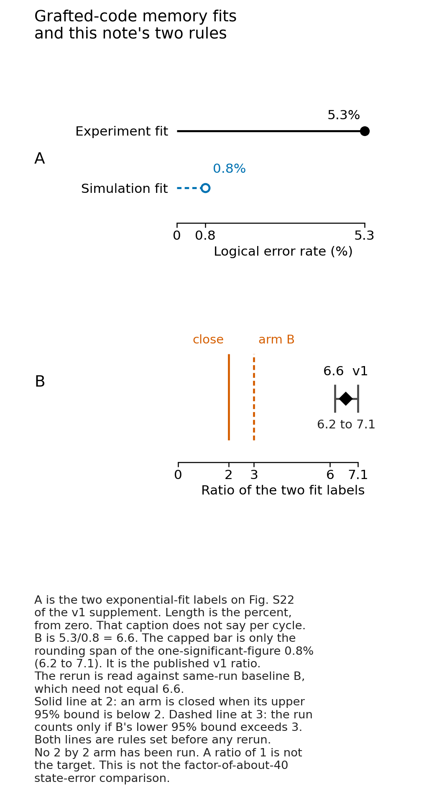

אִם יִרְצֶה הַשֵּׁם

ז׳ חֶשְׁוָן תשפ״ז

# What Would Settle the Leakage Attribution in Magic-State Cultivation on Willow

A reading of the grafted-code memory experiment, with a pre-registered test
Daniyel Yaacov Bilar, Chokmah LLC, chokmah-dyb@pm.me
ORCID: [0000-0002-9040-6914](https://orcid.org/0000-0002-9040-6914)
License: CC BY 4.0, https://creativecommons.org/licenses/by/4.0/
October 18, 2026
No DOI reserved.

## Abstract

Google's 2026 magic-state cultivation experiment on Willow grafts a
cultivated magic state from a distance-3 color code into a
distance-5 code that mixes color-code and surface-code stabilizers.
In the supplement's memory experiment on that grafted code, the
logical error rate is about seven times a depolarizing simulation
that omits leakage. The authors call leakage the likely main cause,
show two leakage signatures in the detector data, and ran no
removal experiment. This note makes three contributions. First, a
reading of the attribution: the authors trace leakage to readout
parameters not optimized for a redefined measurement layout, so a
readout fix that closes the gap would not by itself refute leakage.
The note separates that route from two others that would, if they
also explained the signatures: readout errors that never populate
the |2> state, and variability in physical qubit performance, which
the main text names beside leakage on an earlier grafting figure.
Neither predicts the signatures on its own. Second, a record check: the
public data deposit holds no files for the nine-cycle run behind
the attribution, so no outside party can test it numerically.
Third, a pre-registered experiment: leakage removal crossed with
readout re-optimization, three-state readout in every arm, the
noise strength frozen from a separate control, and pass margins
fixed against a same-run baseline, with a reading assigned to each
outcome. A list of figures easy to quote out of their conditions
closes the note. Until
that experiment runs, the attribution stays likely and not ablated.

## Layman TL;DR

Google's 2026 experiment held a carefully prepared quantum state
for a few rounds of error correction, and it failed about seven
times more often than a simulation predicted. The team thinks the
cause is leakage, a qubit escaping to a third energy level, and
shows two traces of it, but did not run the fix that would prove it.
Uneven quality across qubits is still a possible cause. This note
explains which experiment would settle the question, what each
outcome would mean, and why outsiders cannot check it from the
published data.

## I. The claim and what it rests on

Rosenfeld and a large Google team implemented magic-state
cultivation on Willow [1], the protocol proposed by Gidney, Shutty,
and Jones [2]. A noisy magic state is injected into a distance-3
color code, refined by a fault-tolerant measurement of the logical
Hadamard operator with postselection, and the surviving state is
then grafted into a larger encoding (distance 5, 54 qubits). The
paper calls the target the surface code. During the cycles reported
here the grafted code still contains stabilizers like the color
code's as well as the surface code's, so it is not matchable; the
main text says d - 1 cycles would be needed before switching to a
matchable code, and decodes the grafting data with Tesseract, a
most-likely-error decoder based on A* search [3].

Notation: d is code distance; N is the number of error-correction
cycles in the grafted code; p is the noise strength of SI1000, a
superconducting-inspired circuit-level depolarizing model [4] used
throughout the paper's simulations, sometimes with
added coherent noise; LER is logical
error rate, as the supplement uses it.

Supplement claims here are from arXiv:2512.13908v1 (Dec 15, 2025),
and section and figure numbers are v1's. On Oct. 18, 2026 the scored
items were compared against the published Science supplement:
numbers and wording are unchanged, and only the numbering moved
(Sec. XIV is Sec. VIII there; Figs. S22, S23, S24, and S14 are Figs.
S20, S21, S22, and S11).

The claim sits in the v1 supplement, Section XIV [1], a grafted-code
memory experiment the authors call a start on studying the cost of
error-correction cycles. The cultivated |T> state is idled for up
to N = 9 cycles, and its LER is compared with state-vector
simulations in qevol, the supplement's restricted-rank trajectory
extension of the Pauli+ simulator of [5], using SI1000 at
p = 2.3e-3. The experimental LER is about seven times the simulated
LER. The authors state that population leakage is likely the main
source of the disagreement, and give two signatures, both absent
from the simulations, which do not include leakage:

- Detection-event likelihood rises slowly over time in the
  experimental data (Fig. S23 [1]), as long-lived population
  outside the computational subspace would produce.
- Detector covariance shows strong time correlations that
  propagate across the qubit grid (Fig. S24 [1]), which the authors
  describe as the characteristic leakage pattern.

The circuits contained no leakage removal units of the kind
described in Google's 2023 surface-code paper [5] (the supplement's
reference 49). The 2024 Willow paper [6] used a related step, data
qubit leakage removal (DQLR) [7]; this note does not treat the two
names as the same mechanism. The missing removal units are a
precondition for the attribution, not evidence for it: they let
leakage accumulate, and they would let the other causes in Section
II act just as well. The non-grafted circuits agree with SI1000 at
the same p: the main text reports Fig. 2 in approximate agreement
and Fig. 3 in agreement with simulation, and Fig. S21 shows
qualitative agreement for the kickback-tomography circuits [1]. The
gap is specific to the grafted memory run. The attribution rests on
the two signatures.

"Likely" is the authors' word. No run adds leakage removal units
with everything else held fixed, and no measurement of |2>
population on the grafted circuit has been reported.

## II. Three routes to the gap

The supplement's account of how leakage arises is specific. The
grafting circuit redefines which sub-lattice of qubits is measured
mid-circuit; the readout control parameters were not optimized for
that configuration; that led to possible frequency collisions
involving qubit |2> states, and subsequent leakage [1]. Readout and
leakage are therefore one causal chain in the authors' account, and
listing unoptimized readout as a rival explanation misreads it.
Three routes need to be kept apart:

(a) Readout control parameters, not optimized after the
redefinition, cause |2> collisions, which cause leakage, which
causes the gap. This is the route Section XIV names. It is the
leakage claim.

(b) The same unoptimized readout causes errors that never populate
|2>, such as assignment errors, and those cause the gap. Section XIV
does not name this route. It is this note's alternative, and it
would refute the leakage attribution.

(c) Variability in physical qubit performance. The main text names
it, beside leakage, for the experiment-simulation difference in the
Fig. 4 injection-only tomography [1]. Section XIV, where the
seven-fold gap is reported, does not name it.

A fourth candidate sits outside the physics. Section XIV does not
say the simulated curve was decoded with Tesseract, and the
simulations are state-vector runs, so a decoder or model mismatch
remains open.

The routes differ in what they predict for the two signatures, not
only for the size of the gap. Table 1 sets them side by side.

Table 1. What each route predicts. "Gap" is the excess of
experimental over simulated LER; "S23 rise" is a slow increase in
detection likelihood over the circuit; "S24 spread" is
time-correlated detector covariance that spreads across the grid.

| Route | Gap | S23 rise | S24 spread |
|---|---|---|---|
| (a) readout, then \|2> collisions, then leakage | yes | yes: leaked population is long-lived and accumulates | yes: leakage is time-correlated and can move between qubits |
| (b) readout errors without \|2> | yes | no: assignment errors are independent from cycle to cycle | no: independent errors give no time correlation |
| (c) qubit variability | yes | no: a static error rate does not grow over the circuit | spatial structure only, not time correlation |
| Decoder or model mismatch | possibly | no: S23 is measured before decoding | no: S24 is measured before decoding |

Routes (b), (c), and mismatch can each account for some or all of
the gap's size, but each would need a second mechanism to account
for the signatures. The signatures therefore already favor route
(a) over the others. They do not prove it: other time-correlated
processes, such as slow drift during the circuit, are not excluded,
and the signatures were read from published figures, not from data.
Routes (a) and (b) both predict that re-optimizing readout narrows
the gap. Only a direct measurement of |2> population tells them
apart. That is the design constraint Section IV is built around.

Leakage in topological codes has a literature of its own, from
Suchara, Cross, and Gambetta [8] through McEwen and others [9] and
Battistel, Varbanov, and Terhal [10].

## III. What the public record can and cannot check

The Zenodo record cited in the v1 data-availability line,
10.5281/zenodo.17872003, publishes measurements.csv and
detection_events.csv for Figs. 2, 3, and 4, with Fig. 4 at N = 2 and
N = 3. Opened on Oct. 18, 2026, it has no directory for the N = 9
run behind Figs. S22, S23, and S24. The S23 rise and the S24
covariance can therefore be checked only by eye against the
published figures. Neither can be tested numerically from the
record, and no outside party can fit a leakage model to the data
that carry the attribution. Releasing the N = 9 detection events
would change that at no experimental cost.

An outside simulation check is still possible, with limits. The v1
supplement cites Marshall and Kafri's incoherent approximation of
leakage [11] (its references 38 and 43) for its leakage modeling;
the cultivation team can apply its own implementation directly. No
leakage rates have been measured on the grafted circuit, so an
outside rerun would have to borrow rates from the 2023 paper [5].
That makes it an order-of-magnitude check on whether leakage at
2023-like rates can produce a gap of about seven, not a
reproduction.

The 2023 calibration target is the average detection probability
in [5]. After the Fig. 2 averages there, that average shows a
relative rise of 12% at distance 5 and 8% at distance 3 over 25
cycles, with a typical risetime of roughly 5 cycles, and the
Pauli+ simulation raises it by 7% over 25 cycles at distance 5.
Those are rises in averages over stabilizers of the same weight.
Fig. S23 of [1] reports a slow increase for some detectors, not an
array average, so a match to the 2023 averages would not certify
the shape of those traces. The 2023 target is also a different
processor generation and a plain memory circuit. The grafted-circuit
rise is a prediction of the check, not a fit to Fig. S23.

## IV. The settling experiment

Only the cultivation team can run this. What a note can do is fix,
before the run, what each outcome would mean.

Three-state readout, which resolves |2> and has been used on Google
hardware before [7], [9], can run on the grafted circuit on the
existing Willow processor with the team's runtime. It measures |2>
population on measure qubits every cycle and on data qubits at the
final readout, instead of inferring it from detector signatures.
No other measurement separates route (a) from route (b),
and it is cheap enough to run first, on its own.

The full test is a 2 by 2. Run the grafted-code memory experiment
in four arms: leakage removal units added or not, crossed with
readout control parameters re-optimized for the redefined layout or
left as they were. Every arm carries three-state readout, so each
arm reports its LER ratio, its cycle-resolved |2> population on
measure qubits, and its final |2> population on data qubits.

Four design rules hold for every arm:

1. Fixed p. Freeze p from an unpostselected memory circuit on the
   same qubits on the same day, and use that one value for every
   arm. Do not fit p to the grafted data; a per-arm fit could shrink
   the ratio by construction. The postselected kickback-tomography
   circuit of Fig. 3 serves as a cross-check, not as the
   calibration, because its 8% retention makes a fitted p depend on
   the postselection rule. Because p is re-frozen, the baseline arm
   B need not reproduce the v1 ratio of about 7; every reading below
   is taken against B in the same run.
2. Matched simulation. The simulation for each removal arm includes
   the removal-unit operations at the same SI1000 strength, so that
   the overhead those units add sits in the denominator as well as
   the numerator.
3. Pass margin. The run counts only if B shows a gap: the lower
   95% bound on B's LER ratio must exceed 3. Fix the shot count in
   advance so that the 95% interval on each arm's ratio is no wider
   than plus or minus 15% of B's observed ratio; if B's interval
   comes out wider, add shots before reading any other arm. SI1000
   is itself simplified, so a ratio of exactly one is not the
   target. Call an arm closed when the upper 95% bound on its ratio
   is below 2; unchanged when its interval overlaps B's; widened
   when its lower bound exceeds B's upper bound; narrowed otherwise.
4. |2> criterion. Call an arm leakage-reduced when its mean |2>
   population on measure qubits over cycles 2 to 9, and its final
   |2> population on data qubits, are each below half of B's, with
   non-overlapping 95% intervals.

Table 2. Pre-registered readings of the 2 by 2. Arms: B, baseline
(no removal, readout as in v1); R, readout re-optimized only; L,
leakage removal only; RL, both. "Closed", "narrowed", "unchanged",
and "widened" follow rule 3; "|2> down" follows rule 4. A pattern
not listed is reported as observed and scored inconclusive.

| Pattern | Reading |
|---|---|
| L and RL closed; R not closed | Leakage confirmed by removal; its entry is not the readout path Section XIV names. |
| R closed with \|2> down; L closed | Route (a) confirmed: readout misconfiguration caused leakage, which caused the gap. Leakage confirmed, with its entry path named. |
| R closed without \|2> down | Route (b): the readout path causes the gap without leakage. The leakage attribution fails. |
| L or RL narrowed, not closed | Leakage is one cause among several. The residual goes to route (b), route (c), or decoder or model mismatch. |
| All arms unchanged | The attribution fails. The signatures in Figs. S23 and S24 [1] need another explanation. |
| L or RL widened | Removal overhead dominates at this scale despite rule 2. Inconclusive, and reported as such. |

The authors say they expect improvement from leakage removal, better
calibration, and larger distances. Follow-up work can be read
against Table 2 by which row it reports, and by whether it reports
the rerun at all.

## V. Numbers to cite with care

Several figures from the cultivation paper are easy to quote out of
their conditions.

- The headline factor. The Science abstract, retrieved on Oct. 18,
  2026, says cultivation reduces the error by a factor of 40, with a
  state fidelity of at least 0.9999(1), retaining 8% of attempts.
  The v1 preprint gives injection-only error 4.4(2)e-3, which the
  main text calls "similar to our physical qubit gate errors" [1],
  and cultivated full-circuit error between 1e-4 and 2e-4: a ratio
  of about 22 to 44. "About 40" sits at the low-error end. The v1
  abstract states the fidelity as 0.9999(1), without "at least".
- The seven-fold gap. Fig. S22 labels the experimental panel (b)
  "Exp. fit, LER = 5.3%" and the simulation panel (e) "Exp. fit,
  LER = 0.8%"; "Exp. fit" reads as an exponential fit. The caption
  gives LER "as a function of N" and does not say whether these are
  per cycle. The 0.8% carries one significant figure, so the ratio
  lies between about 6.2 and 7.1 from rounding alone. The gap is
  one figure, one grafted configuration, and at most nine cycles.
  The factor of 40 and the factor of seven are different
  measurements: state error against injection, and memory LER
  against SI1000.

Figure 1 draws that gap beside the two rules in Section IV.

Figure 1. Top: the Fig. S22 exponential-fit labels, experiment
5.3% and SI1000 simulation 0.8%, drawn from zero. That caption
does not say the percents are per cycle. Bottom: the ratio
5.3/0.8 = 6.6. The capped bar is only the rounding span of the
one-significant-figure 0.8% (6.2 to 7.1). It is the published v1
ratio. The rerun is read against same-run baseline B, which need
not equal 6.6. The solid line at 2 is the close line: an arm is
closed when its upper 95% bound is below 2. The dashed line at 3
is the gate: the run counts only if B's lower 95% bound exceeds 3.
Both lines were fixed before any rerun. No 2 by 2 arm has been run.

- Two noise strengths. The main text uses p = 3.0e-3 for Fig. 2 and
  p = 2.3e-3 for Figs. 3 and 4, attributes the change to shifted
  qubit frequencies and different control calibrations, and reports
  logical-error variation of about 1e-4 over an hour. Section XIV
  carries p = 2.3e-3 over from Fig. 4; the seven-fold gap is
  relative to that value.
- The residual detuning bound. Early tomography of cultivated
  states returned non-physical norms, which the supplement
  attributes to low-frequency phase noise and which led the team to
  build kickback tomography. With echoing, a simulation bounds the
  remaining |T> infidelity from quasi-static detunings near 1e-5.
  That bound assumes plus or minus 200 kHz quasi-static detunings
  and no depolarizing noise, and Fig. S14c still shows non-physical
  norms for some echoed draws.
- Distance to application targets. The paper's introduction states
  that infidelities of about 1e-10 are needed to factor an RSA-2048
  key, citing Gidney [12], and about 1e-6 to 1e-8 for some
  simulation and optimization tasks. The measured value, near 1e-4,
  is about six orders of magnitude from 1e-10. The supplement shows
  cultivated error scaling as p cubed in simulation. My own
  extrapolation from that fit, at fixed distance 3: halving p would
  give about 1.3e-5 to 2.5e-5, still above the 1e-6 to 1e-8 band. Neither
  [1] nor [2] makes that projection, and the protocol [2] reaches
  its low error rates at larger distance.

## VI. Context: the 2024 inventory

This note grew out of the author's 2024 note on Willow [13], which
listed six error channels that the simplified Pauli model behind
Google's 2024 predictions [6] omitted or treated thinly. Read
against that list, the cultivation experiment bears on one channel,
leakage, and only through the attribution examined above. It does
not test crosstalk, which appears only as a candidate source of
detunings; its correlated detector features are tied by the authors
to leakage and so add no independent evidence; it reuses the gate
and readout baseline; and it does not address classical chaos [14].
The third-party objections tracked in [13] (noise sensitivity [15],
[16]; nonlinear errors [17]; reachability deficits [18]; classical
chaos
[14]) are not tested, and their 2024 grades, read from the author's
mirror of that note [19], stand unchanged. None of the 2024 channels
was unknown to Google, whose 2024 error budget already carried
leakage.

## VII. Limitations

The author wrote the 2024 note in Section VI. All figure pins and
the "likely" wording are from arXiv:2512.13908v1; the published
Science supplement was compared on those items only. The Zenodo
record holds no N = 9 data, so the signatures were read from the
published figures, not recomputed. I did not rerun the paper's
simulations. The repository behind this note holds a distance-3
calibration run of a local leakage simulator; it is not a result of
this note. The pass margin and |2> criterion in Section IV are my
choices, fixed here before any rerun. The attribution examined here
rests on one grafted-code memory figure, one configuration, and at
most nine cycles.

## VIII. Conclusion

The seven-fold gap in the grafted-code memory experiment has a
named cause, leakage, that the authors call likely, support with
two signatures, and have not ablated. Their own account puts
readout misconfiguration upstream of the leakage, so the decisive
question is whether the gap travels with |2> population. Route (b),
qubit variability, and decoder or model mismatch remain open. Two
steps would settle it: release the N = 9 detection events, and run
the 2 by 2 with three-state readout under the rules fixed in
Section IV.

## Availability

The source pins, review files, and local simulator will be
deposited on Zenodo with this note's DOI. No DOI is minted yet, and the working repository is not public.

## AI Utilization Statement

This note was prepared with AI assistance, directed by the author at
every stage. Muse (Meta) agents (model version not recorded) located
and read the primary sources, cross-checked numbers and attributions
in the draft against them, and drafted the text at the author's
instruction. Grok 4.6 applied the author's 2023 rise-leg
substitution to the v3 Section V wording, then a later
critical-review pass (abstract citations, table captions, v3 Section V hardware split,
Limitations local-instrument line). The leakage simulator in the
repository was written by OpenAI GPT-6 Astra through OpenRouter from
the author's briefs, then reviewed and tested before use; a
distance-3 calibration run of it is recorded in the repository and
is not a result of this note. The draft then went through two
internal adversarial passes (a spec-faithful claims trace and an
independent adversarial review), and two external critical
evaluations commissioned by the author through OpenRouter, from
Moonshot Kimi K3 and Anthropic Claude Opus 5.5. Claude (Anthropic),
through Claude Code, ran a further critical review of v3 and applied
its findings to produce v4, checking each change against the local
copy of arXiv:2512.13908v1, and at the author's direction
restructured v4 into v5 around the attribution test, then reviewed
v5 and applied its findings to produce v6. Every finding
from those passes was adjudicated before any revision was applied.
The review files will be part of the Zenodo deposit when minted.
They have no public URL yet. The author selected all sources, made
every publish and revise decision, and takes responsibility for the
claims and the conclusions. AI output was treated as draft
throughout. Claims here were checked against arXiv:2512.13908v1 and
the Science abstract [1], and the scored items were compared against
the published Science supplement. Grok 4.7 drew Figure 1 and the
whiteboard sketchnote from numbers already in this note. Neither
is a new measurement. No AI system is listed as a co-author.

Affiliation: Chokmah LLC, Norwich, VT. Contact: chokmah-dyb@pm.me.

## References

[1] E. Rosenfeld, C. Gidney, et al., Google Quantum AI and Collaborators, "Magic state cultivation on a superconducting quantum processor," *Science*, First Release, Oct. 15, 2026 (no volume or pages yet). doi: 10.1126/science.aee7961. Accessed: Oct. 18, 2026. Supplement claims in this note are from arXiv:2512.13908v1, Dec. 15, 2025. [Online]. Available: https://doi.org/10.1126/science.aee7961

[2] C. Gidney, N. Shutty, and C. Jones, "Magic state cultivation: growing T states as cheap as CNOT gates," *arXiv preprint*, arXiv:2409.17595, 2024. Accessed: Oct. 18, 2026. [Online]. Available: https://arxiv.org/abs/2409.17595

[3] L. A. Beni, O. Higgott, and N. Shutty, "Tesseract: A search-based decoder for quantum error correction," *arXiv preprint*, arXiv:2503.10988, 2025. Accessed: Oct. 18, 2026. [Online]. Available: https://arxiv.org/abs/2503.10988

[4] C. Gidney, M. Newman, A. Fowler, and M. Broughton, "A fault-tolerant honeycomb memory," *Quantum*, vol. 5, p. 605, 2021. doi: 10.22331/q-2021-12-20-605. Accessed: Oct. 18, 2026. [Online]. Available: https://doi.org/10.22331/q-2021-12-20-605

[5] Google Quantum AI and Collaborators, "Suppressing quantum errors by scaling a surface code logical qubit," *Nature*, vol. 614, pp. 676-681, 2023. doi: 10.1038/s41586-022-05434-1. Accessed: Oct. 18, 2026. [Online]. Available: https://doi.org/10.1038/s41586-022-05434-1

[6] Google Quantum AI and Collaborators, "Quantum error correction below the surface code threshold," *Nature*, vol. 638, pp. 920-926, 2025 (published online Dec. 2024). doi: 10.1038/s41586-024-08449-y. Accessed: Oct. 18, 2026. [Online]. Available: https://doi.org/10.1038/s41586-024-08449-y

[7] K. C. Miao et al., "Overcoming leakage in quantum error correction," *Nature Physics*, vol. 19, pp. 1780-1786, 2023. doi: 10.1038/s41567-023-02226-w. Accessed: Oct. 18, 2026. [Online]. Available: https://doi.org/10.1038/s41567-023-02226-w

[8] M. Suchara, A. W. Cross, and J. M. Gambetta, "Leakage suppression in the toric code," *Quantum Information and Computation*, vol. 15, pp. 997-1016, 2015. doi: 10.26421/QIC15.11-12-8. Accessed: Oct. 18, 2026. [Online]. Available: https://doi.org/10.26421/QIC15.11-12-8

[9] M. McEwen et al., "Removing leakage-induced correlated errors in superconducting quantum error correction," *Nature Communications*, vol. 12, p. 1761, 2021. doi: 10.1038/s41467-021-21982-y. Accessed: Oct. 18, 2026. [Online]. Available: https://doi.org/10.1038/s41467-021-21982-y

[10] F. Battistel, B. Varbanov, and B. Terhal, "Hardware-efficient leakage-reduction scheme for quantum error correction with superconducting transmon qubits," *PRX Quantum*, vol. 2, p. 030314, 2021. doi: 10.1103/PRXQuantum.2.030314. Accessed: Oct. 18, 2026. [Online]. Available: https://doi.org/10.1103/PRXQuantum.2.030314

[11] J. Marshall and D. Kafri, "Incoherent approximation of leakage in quantum error correction," *Physical Review Applied*, vol. 23, p. 054025, 2025. doi: 10.1103/PhysRevApplied.23.054025. Accessed: Oct. 18, 2026. [Online]. Available: https://doi.org/10.1103/PhysRevApplied.23.054025

[12] C. Gidney, "How to factor 2048 bit RSA integers with less than a million noisy qubits," *arXiv preprint*, arXiv:2505.15917, 2025. Accessed: Oct. 18, 2026. [Online]. Available: https://arxiv.org/abs/2505.15917

[13] D. Y. Bilar, "Notes on Google Willow (2024)," preprint, 2024. doi: 10.13140/RG.2.2.30911.01443. Accessed: Oct. 18, 2026. [Online]. Available: https://www.researchgate.net/publication/387576664_Notes_on_Google_Willow_2024_aka_Quantum_Error_Correction_Below_the_Surface_Code_Threshold

[14] S.-D. Boerner et al., "Classical chaos in quantum computers," *arXiv preprint*, arXiv:2304.14435, 2023. Accessed: Oct. 18, 2026. [Online]. Available: https://arxiv.org/abs/2304.14435

[15] G. Kalai, "The Quantum Computer Puzzle," *arXiv preprint*, arXiv:1605.00992, 2016. Accessed: Oct. 18, 2026. [Online]. Available: https://arxiv.org/abs/1605.00992

[16] G. Kalai, Y. Rinott, and T. Shoham, "Questions and concerns about Google's quantum supremacy claim," *arXiv preprint*, arXiv:2305.01064, 2023. Accessed: Oct. 18, 2026. [Online]. Available: https://arxiv.org/abs/2305.01064

[17] O. Hirota, "Introduction to semi-classical analysis for digital errors of qubit in quantum processor," *Entropy*, vol. 23, no. 12, p. 1577, 2021. doi: 10.3390/e23121577. Link check: Oct. 18, 2026 (doi.org returned 403). [Online]. Available: https://doi.org/10.3390/e23121577

[18] M. S. Akshay, H. Philathong, M. E. S. Morales, and J. D. Biamonte, "Reachability deficits in quantum approximate optimization," *Physical Review Letters*, vol. 124, p. 090504, 2020. doi: 10.1103/PhysRevLett.124.090504. Accessed: Oct. 18, 2026. [Online]. Available: https://doi.org/10.1103/PhysRevLett.124.090504

[19] D. Y. Bilar, "Assessment of quantum error correction below the surface code threshold," Mataroa blog mirror of [13]. Accessed: Oct. 18, 2026. [Online]. Available: https://dybilar.mataroa.blog/blog/assessment-of-quantum-error-correction-below-the-surface-code-threshold/
