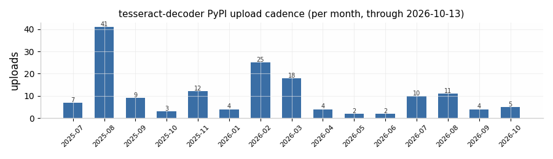
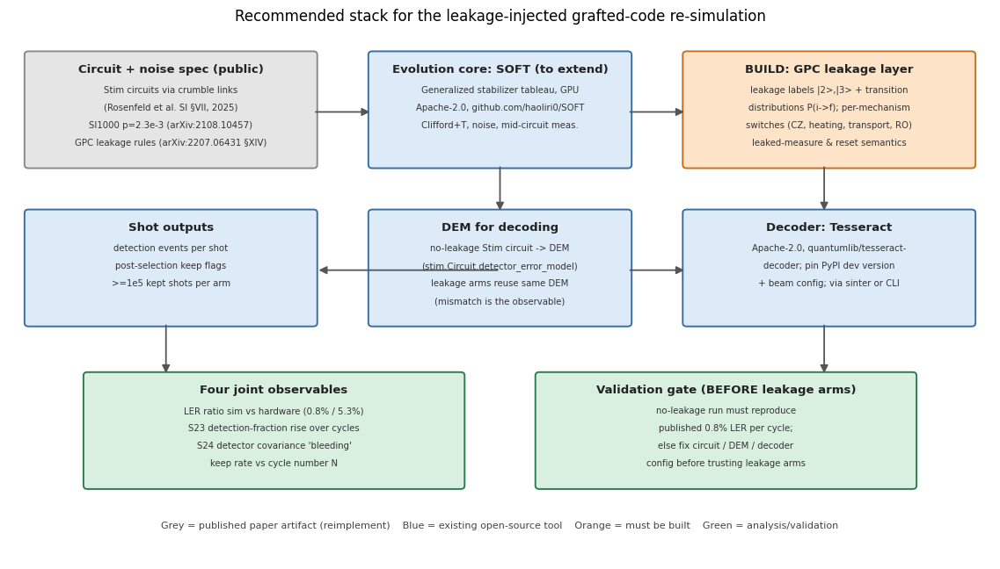

# Tooling for a Leakage-Injected Re-simulation of the Grafted-Code Memory Experiment: A Sourced Capability Study

**Research date: 2026-10-17.** Scope: the software stack required for an independent team to re-simulate the grafted-code memory experiment of Rosenfeld et al., *Magic state cultivation on a superconducting quantum processor* (arXiv:2512.13908v1, Sections V, XI, XIV, Figs. S22–S24) — a distance-3 color code grafted to a distance-5 surface code, 54 qubits, SI1000 depolarizing noise at p = 2.3×10⁻³ — with per-mechanism population-leakage channels added, decoded by Tesseract, at ≥10⁵ kept shots per arm after post-selection.

---

## Executive summary

**No single open tool, and no documented combination of open tools, currently meets all four requirements imposed by the external review.** The published simulation was produced by **qevol**, an internal Google simulator that is described mathematically but not released ([arXiv:2512.13908v1, §XI.2](https://arxiv.org/html/2512.13908v1)), and the leakage formalism it would need — the **Pauli+/GPC** layer — is likewise paper-specified but not released ([arXiv:2207.06431v2, §XIV.2.2](https://arxiv.org/html/2207.06431v2)). The decoder, by contrast, is fully public: **Tesseract** is Apache-2.0 open source at `quantumlib/tesseract-decoder`, takes Stim Detector Error Models (DEMs), and is actively maintained, but **no version number or configuration behind the published 0.8%-per-cycle figure has ever been published** — the cultivation paper names the decoder without giving a single setting ([arXiv:2512.13908v1, §III](https://arxiv.org/html/2512.13908v1)).

The situation changed materially in late 2025 and 2026. **SOFT** (arXiv:2512.23037, Apache-2.0, `github.com/haoliri0/SOFT`) is the first open-source, qevol-class simulator: a GPU generalized-stabilizer-tableau engine that handles noisy Clifford+T circuits with mid-circuit measurements and has already simulated the distance-5 cultivation circuit at 42 qubits / 72 T gates ([arXiv:2512.23037v1](https://arxiv.org/html/2512.23037v1)). It has **no leakage support**. On the leakage side, Riverlane's **deltakit-stim** (released 2026-04, Apache-2.0) adds leakage channels, transport, and heralded leakage events to Stim, but is stabilizer-only — it cannot represent the magic-state input or the T gates of the cultivation circuit — and its current leakage physics is depolarizing-only ([Riverlane, 2026-04-16](https://www.riverlane.com/news/introducing-deltakit-stim)). The smallest build that closes the gap is therefore **SOFT + a GPC leakage layer reimplemented from the 2023 Google supplement + Tesseract**, an estimated **3–6 person-month** effort dominated by the leakage layer and its validation, not person-weeks, because the leaked-qubit measurement/reset semantics must interact correctly with the coefficient-list state representation and with post-selection.

On the review's unverified claim (question E): **the claim holds in its strict form.** Figure S22(e) is a qevol simulation of the *full protocol* — injection, cultivation with physical T/T† gates, grafting, and N idling cycles — and a 2023-faithful Pauli+ simulator tracks a single stabilizer state plus leakage labels, so it can neither represent the |T⟩ input nor apply the cultivation T gates ([arXiv:2207.06431v2, §XIV.2.2](https://arxiv.org/html/2207.06431v2), [arXiv:2512.13908v1, §XIV](https://arxiv.org/html/2512.13908v1)). The implication for tool choice is that the non-stabilizer-capable evolution layer is mandatory, not optional; Pauli+-class tools (Stim, deltakit-stim) can only run reduced "stabilizer-input memory" arms. Prior art outside Google (question F) reaches leakage-injected surface-code memory at d = 11–19 with public artifacts (ERASER, GLADIATOR) and qutrit-leakage tensor-network simulations at few-hundred-qudit scale, but **no group has published a leakage-injected re-simulation of a grafted or full 2D surface-code memory experiment with a non-stabilizer input and experiment-matched detector covariances** — the proposed experiment would be the first of its kind.

---

## 1. The instrument, restated as checkable tool requirements

The external review's four requirements decompose into seven checkable capabilities, which are used as the columns of the capability matrix in Section 8. This restatement matters because several candidate tools satisfy the *spirit* of one requirement while failing a specific sub-clause — Stim, for example, is routinely described as "supporting QEC simulation," yet its own author states that it cannot sample time-correlated errors such as leakage within its circuit format ([C. Gidney, QC Stack Exchange, 2022](https://quantumcomputing.stackexchange.com/questions/27295/support-for-qubit-leakage-errors-in-stim)).

| ID | Requirement (from the review) | Checkable capability |
|---|---|---|
| R1 | qevol-style evolution: superpositions of stabilizer states | Simulator represents/evolves a non-stabilizer state as a coefficient list over a stabilizer-group basis (or equivalent) at ~54 qubits with T gates |
| R2 | Pauli+-style leakage layer | Leakage labels beyond \|1⟩ (\|2⟩, \|3⟩) tracked per qubit per shot, with generalized Pauli channels over those labels |
| R3 | Per-mechanism injection | CZ \|11⟩→\|02⟩ on the higher-frequency qubit, passive heating, measure↔data transport, and readout-induced leakage, each **separately switchable** (incl. transport-off control) |
| R4 | Documented leaked-qubit semantics | Explicit rules mapping a leaked qubit's measurement to a classical 0/1 and its reset behavior |
| R5 | Decoder = Tesseract | Public decoder accepting Stim DEMs; version/config pinnable; no-leakage arm reproduces 0.8%/cycle |
| R6 | Detector sampling + post-selection | Per-shot detection events, keep-rate statistics vs cycle number N, detector covariance |
| R7 | Scale | ≥10⁵ kept shots per arm after post-selection on workstation-class (or small GPU) hardware |

Two facts from the supplement frame everything that follows. First, the experiment's own circuits are public: Section VII of the SI attaches **crumble links for the explicit circuits used for each element of the main text, constructed using Stim, with detectors included** ([arXiv:2512.13908v1, §VII](https://arxiv.org/html/2512.13908v1)), and the theory-side cultivation circuits are archived on Zenodo ([Gidney, 2024](https://zenodo.org/records/13777072)). Second, the published simulations that produced Fig. S22(d–f) were run with **qevol under SI1000 depolarizing noise only — "simulations (right), which do not include leakage approximations"** — so the leakage-injected hybrid the review demands was *never* the instrument behind the 0.8% figure; the 0.8% figure is a no-leakage baseline, which is precisely why it can serve as the validation gate ([arXiv:2512.13908v1, §XIV](https://arxiv.org/html/2512.13908v1)).

The noise-model side is fully specified in public documents. SI1000 is defined in the honeycomb-memory paper ([Gidney et al., *Quantum* 5, 605 (2021)](https://arxiv.org/abs/2108.10457)), and the per-mechanism leakage physics — CZ-state leakage with nominal probability p₂^CZ = 0.25·p_t = 2.0×10⁻⁴, heating rates Γ₁→₂, transport, and the GPC channel structure — is specified in Section XIV of the 2023 surface-code supplement ([arXiv:2207.06431v2](https://arxiv.org/html/2207.06431v2)), building on the leakage quantification formalism of Wood and Gambetta ([PRA 97, 032306 (2018)](https://journals.aps.org/pra/abstract/10.1103/PhysRevA.97.032306)). What is *not* public is any code that executes these specifications together with a non-stabilizer input state.

---

## 2. (A) Tesseract: availability, configuration, and the 0.8% provenance question

### 2.1 Open-source status, license, and maintenance

Tesseract **is open source**: the repository `github.com/quantumlib/tesseract-decoder` hosts a C++ implementation with a Python wrapper, **licensed under Apache 2.0**, copyrighted by Google LLC in 2025, with the explicit disclaimer that it "is not an officially supported Google product" ([quantumlib/tesseract-decoder](https://github.com/quantumlib/tesseract-decoder)). The accompanying paper is Beni, Higgott, and Shutty, *Tesseract: A Search-Based Decoder for Quantum Error Correction* (arXiv:2503.10988, 2025-03-14), which describes the A* most-likely-error search over error subsets with pruning heuristics ([arXiv:2503.10988v1](https://arxiv.org/html/2503.10988v1)). Installation is via Bazel build or `pip install tesseract-decoder` ([GitHub README](https://github.com/quantumlib/tesseract-decoder)).

**Maintenance status is active but pre-1.0.** The GitHub Releases page contains no tagged releases ("There aren't any releases here") ([releases page](https://github.com/quantumlib/tesseract-decoder/releases)); distribution happens through PyPI, where the first upload appeared on 2025-07-15 and **157 uploads** followed through 2026-10-13, all in the `0.1.1.dev*` series — i.e., rolling development snapshots, not semantic releases (PyPI release metadata, retrieved 2026-10-17; see figure below). An independent optimization study from February 2026 confirms the project is alive and accepting external work, archiving its speedups as merged pull requests ([arXiv:2602.02985v2](https://arxiv.org/html/2602.02985v2)). For a replication build, the practical pinning rule is therefore **PyPI dev-version string + Git commit hash**, recorded in the experiment's reproducibility manifest, with a frozen environment — the absence of tagged releases is a provenance inconvenience, not a blocker.

### 2.2 Does the public version expose the cultivation team's configuration?

Partially, and this is the soft spot in requirement R5. The public Tesseract exposes every relevant knob: heuristic flags `--beam`, `--det-penalty`, `--beam-climbing`, `--no-revisit-dets`, `--at-most-two-errors-per-detector`, `--pqlimit`, plus detector-order seeds and error sparsification, and it ships **two named parameter sets, `tesseract-short-beam` and `tesseract-long-beam`, identified in the README as "the two sets of parameters used in the Tesseract paper"**, as sinter decoder presets ([GitHub README](https://github.com/quantumlib/tesseract-decoder)). So the *machinery* of the cultivation team's configuration is public.

However, **there is no published record of the exact version or settings behind the 0.8%-per-cycle figure.** A full-text search of the cultivation paper and its supplement finds Tesseract mentioned only as "a most likely error decoder using the A* search technique [4]" used to decode the grafted code — no beam width, no version, no seed policy ([arXiv:2512.13908v1, §III](https://arxiv.org/html/2512.13908v1)). The 0.8% value itself lives in Fig. S22(e) (the supplement text states only that the experimental LER is "about seven times higher than expected from simulations") ([arXiv:2512.13908v1, §XIV](https://arxiv.org/html/2512.13908v1)). Consequence for the build: the review's requirement — "pin its version and configuration tightly enough that a no-leakage run reproduces the published 0.8% per cycle before any leakage arm is trusted" — **cannot be satisfied by citation; it must be satisfied by calibration.** The team should treat reproducing 0.8% as a fitting target over the small space {PyPI version × named preset × seed policy}, which is tractable precisely because the DEM is reconstructable from the published Stim circuits (Section 2.3). This is a person-days calibration task, but it is *unverified* until executed, and it should be scheduled before any leakage development begins.

### 2.3 Detector error model format and Stim pairing

Tesseract's native input is the **Stim DetectorErrorModel (DEM)**: the paper explicitly adopts Stim's DEM terminology "to best mirror the source code," and the README confirms it "processes Stim circuit files and Detector Error Model files with arbitrary error models," with Stim as a direct build dependency ([arXiv:2503.10988v1](https://arxiv.org/html/2503.10988v1), [GitHub README](https://github.com/quantumlib/tesseract-decoder)). The pairing with Stim is therefore first-class in both directions: `stim.Circuit.detector_error_model()` produces the DEM from the same circuit that generates shots, and Tesseract can either sample shots from a Stim circuit itself (`--circuit ... --sample-num-shots N`) or decode externally generated detection events via `--in events.01 --in-format 01 --dem ...` — the latter mode being exactly what a hybrid simulator needs, since the leakage-injected shots will come from the new simulator, not from Stim ([GitHub README, usage section](https://github.com/quantumlib/tesseract-decoder)). First-class **sinter integration** (`make_tesseract_sinter_decoders_dict()`) provides the standard shot-collection, statistics, and CSV pipeline used across the Stim ecosystem ([GitHub README](https://github.com/quantumlib/tesseract-decoder)).

One documented subtlety matters for the color-code-like grafted lattice: Tesseract offers `--sparsify-errors` with the recommendation to set the base degree **K = 3 for color codes** (K = 2 for surface codes), reflecting the higher-degree error mechanisms of non-matchable codes — a hint that the grafted code, whose hypergraph mixes color-code-like and surface-code-like stabilizers, sits in the regime Tesseract was tuned on ([GitHub README, performance section](https://github.com/quantumlib/tesseract-decoder)). The Tesseract paper itself benchmarks surface codes, color codes, bivariate-bicycle codes, and transversal-CNOT protocols, so the decoder's accuracy envelope on color-code-like DEMs is published and checkable against the replication's own no-leakage arm ([arXiv:2503.10988v1](https://arxiv.org/html/2503.10988v1)).

---

## 3. (B) Leakage-capable simulators, tool by tool

Each candidate is scored against R1 (non-stabilizer/stabilizer-superposition input), R2 (leakage labels beyond \|1⟩), R3 (per-mechanism channels), R4 (leaked measurement/reset semantics), R6 (detector sampling + post-selection), and R7 (scale). "Supports" means the capability exists in public code or documentation today, with a source; "could be extended" is stated as such.

### 3.1 Stim (+ sinter): the baseline that everything plugs into

Stim (`quantumlib/Stim`, Apache-2.0, *Quantum* 5, 497 (2021)) is the ecosystem's reference stabilizer simulator: kilohertz-rate shot sampling, `detector_error_model()` for DEM generation, and — via sinter — standard post-selection and statistics workflows ([quantumlib/Stim](https://github.com/quantumlib/stim)). For this experiment it already supplies R5's DEM and much of R6's plumbing, and the published circuits are Stim circuits ([arXiv:2512.13908v1, §VII](https://arxiv.org/html/2512.13908v1)).

Its limits are exactly the review's core requirements. **R1: no** — Stim simulates stabilizer circuits; a |T⟩ input or a transversal T layer is outside its model. **R2/R3: no native support** — asked directly about leakage in Stim, its author answered that "stim's circuit format doesn't have good capability for sampling time correlated errors like leakage. You will have to use the tableau simulator and track the leakage yourself," publishing a reference pattern that drives `stim.TableauSimulator` instruction-by-instruction with an external leaked-qubit set, spread-on-CZ rules, and decay-on-TICK rules ([C. Gidney, QC Stack Exchange, 2022-07-11](https://quantumcomputing.stackexchange.com/questions/27295/support-for-qubit-leakage-errors-in-stim)). That pattern is a legitimate *extension path* (Python-level, per-shot serial — the throughput cost at 10⁶+ shots is significant but the semantics are fully user-controlled, so R4 is "define your own"), and for the **reduced arm** of the experiment — stabilizer-input grafted memory without cultivation — a Stim+TableauSimulator leakage wrapper remains a viable cross-check instrument. It cannot run the S22 circuit itself.

### 3.2 deltakit-stim (Riverlane): the only open Stim-native leakage extension

Deltakit-Stim is a Stim fork that "adds support for non-computational leakage errors and an adaptive detector error model," released publicly in April 2026 ([Riverlane, 2026-04-16](https://www.riverlane.com/news/introducing-deltakit-stim)), distributed on PyPI (version **0.2.7**, retrieved 2026-10-17) and developed under the Apache-2.0 `deltakit` organization ([pypi.org/project/deltakit-stim](https://pypi.org/project/deltakit-stim/), [github.com/deltakit/deltakit](https://github.com/deltakit/deltakit)). Its instruction set adds `LEAKAGE(p)`, a leakage reset `RL`, and `HERALD_LEAKAGE_EVENT` which writes leakage occurrence into the measurement record for detectors to consume; two-qubit gates model leakage spreading and transfer with configurable rates; and it emits **adaptive DEMs** carrying heralded, leakage-conditional error mechanisms for leakage-aware decoders ([PyPI documentation](https://pypi.org/project/deltakit-stim/)). Against the matrix: **R2 partial** (it tracks an in/out-of-computational-subspace register per qubit — whether multiple distinct levels \|2⟩ vs \|3⟩ are represented is *unverified* from public docs); **R3 partial** (transport across 2Q gates is configurable, but the current noise physics is explicitly **"a depolarising model of leakage … with additional noise models planned for future releases"** — the 2023-faithful per-mechanism GPC distributions are not what it ships ([Riverlane, 2026-04-16](https://www.riverlane.com/news/introducing-deltakit-stim))); **R1: no** (Stim-based, stabilizer-only); **R6: yes**, including herald-aware DEMs.

Two deployment caveats belong in the record. First, parts of the leakage workflow are **cloud-gated**: the Deltakit authentication documentation lists "adding leakage noise," "leakage noise simulation," and decoding with the proprietary LC/AC/CC decoders among features that require an authenticated token and server requests ([Deltakit docs, authentication](https://deltakit-docs.riverlane.com/en/docs/guide/authentication.html)) — the open `deltakit-stim` fork itself runs locally, but an independent team should verify which leakage features execute without the cloud before designing around them (*unverified* at the granularity of individual API calls). Second, Riverlane's leakage-aware Local Clustering Decoder is **proprietary** (FPGA-oriented, Nature Communications 16, 2025), not open source ([Riverlane, 2026-04-16](https://www.riverlane.com/news/introducing-deltakit-stim)). Neither caveat blocks this experiment — the decoder is fixed to Tesseract by requirement — but both matter for anyone hoping deltakit-stim is a drop-in Pauli+ replacement: it is not one yet, and its maintainers describe it as narrowing "a long-standing gap," not closing it.

### 3.3 Qiskit Aer extended stabilizer: qevol-adjacent, CPU-bound, no leakage

Qiskit Aer's **extended stabilizer simulator** implements the stabilizer-decomposition method for Clifford+T circuits with noise and mid-circuit measurements — the same algorithmic family as qevol/SOFT — and is documented with an official tutorial ([Qiskit Aer extended stabilizer tutorial](https://qiskit.github.io/qiskit-aer/tutorials/6_extended_stabilizer_tutorial.html)). SOFT's authors used it as a correctness cross-check for small Clifford+T circuits with injected Pauli noise, where it matched their GPU engine exactly ([arXiv:2512.23037v1, §V-B](https://arxiv.org/html/2512.23037v1)).

For this experiment it fails on throughput and on leakage. In SOFT's benchmarks on d=3/d=5 cultivation circuits, the extended stabilizer backend (CPU, i7) was **>10⁴× slower** than SOFT on a single H800 GPU, with the gap growing with circuit complexity (Table V of [arXiv:2512.23037v1](https://arxiv.org/html/2512.23037v1)); at 10⁵ kept shots with an ~8% keep rate (≈1.3×10⁶ raw shots) that penalty is disqualifying for anything but validation slices. **R2/R3: no** — the extended stabilizer method is qubit-based; Aer's qutrit/leakage capacity exists only in statevector and density-matrix backends whose 3⁵⁴ storage is impossible at 54 qubits. Verdict: a *reference oracle* for validating the hybrid on small subcircuits (d=3 cultivation, ≤~20 qubits), not the production engine.

### 3.4 Cirq: qudit channels exist, the scalable path does not

Cirq supports qudits as first-class `Qid`s and arbitrary Kraus channels in its density-matrix and Monte-Carlo wavefunction simulators, so a qutrit leakage channel is expressible in a few lines (`cirq.NamedQid("q", 3)` plus a custom channel) ([Cirq noisy simulation docs](https://quantumai.google/cirq/simulate/noisy_simulation), [QC Stack Exchange qutrit channel example, 2024](https://quantumcomputing.stackexchange.com/questions/38051/how-to-implement-a-depolarizing-noise-channel-for-qutrits-using-cirq)). But every such backend scales exponentially in qudit count; Cirq has **no stabilizer-class simulator with leakage labels and no DEM/detector infrastructure** comparable to Stim's. R1 is similarly unavailable at scale (statevector only). Verdict: **could be extended** only in the same sense as any statevector tool — irrelevant at 54 qubits; useful, like Qiskit Aer, for small-scale semantics validation of leaked-measurement rules. Not recommended as a build base.

### 3.5 PECOS: honest about what it is

PECOS (`PECOS-packages/PECOS`, Apache-2.0, Rust core with Python API, actively maintained with commits within days of this writing) now ships **QutritStateVec and QutritDensityMatrix backends using the basis {\|0⟩, \|1⟩, \|L⟩}, supporting arbitrary local unitaries, embedded qubit gates, Kraus channels, and leakage-aware measurement instruments** ([PECOS simulators guide](https://github.com/PECOS-packages/PECOS/blob/dev/docs/user-guide/simulators.md)). The documentation is unusually candid about scope: these are **"reference backends for physical leakage and noise-model verification, not replacements for PECOS's scalable stabilizer simulators or the classical leakage bookkeeping used in large QEC studies,"** with storage scaling 3^N ([PECOS simulators guide](https://github.com/PECOS-packages/PECOS/blob/dev/docs/user-guide/simulators.md)). Its stabilizer simulators are qubit-only; a `StabVec` Clifford+Rz backend exists, but its cost on T-dense cultivation circuits is undocumented (*unverified* for R1 at 54 qubits). Verdict: same role as Qiskit Aer — a modern, well-engineered small-scale leakage oracle — not the production engine. Do not cite PECOS as "supporting" R2/R3 at experimental scale; its own docs disclaim exactly that.

### 3.6 Tensor-network (MPS) leakage simulation: the strongest leakage physics, the wrong geometry

The MPS methodology of arXiv:2308.08186 (published NJP, 2025) is the most physically ambitious open literature on leakage simulation: **qutrit systems with coherent leakage rotations, thermal (heating) noise, leakage spreading, explicit measurement instruments that classify a leaked qutrit as 0/1 with probability ½, and MLR/DQLR leakage-removal strategies — no twirling approximation** — at up to a few hundred qudits and many cycles, on a single CPU node ([arXiv:2308.08186v2](https://arxiv.org/html/2308.08186v2)). Its R4 semantics are the best-documented in the public literature outside Google's own supplements, and its central scientific warning — that incoherent (twirled) approximations of coherent leakage **can significantly overestimate** the logical error rate — bears directly on how much faith to place in any GPC-only leakage arm ([arXiv:2308.08186v2, §VI](https://arxiv.org/html/2308.08186v2)).

The geometry kills it for this experiment: the method is demonstrated on the **1D repetition code and thin 3×d surface codes**, and the authors state that 2D codes "will likely require tensor network ansatz beyond MPS, which we leave to future work" ([arXiv:2308.08186v2, §IV.1](https://arxiv.org/html/2308.08186v2)). A 54-qubit 2D grafted lattice with weight-6 stabilizers is firmly outside the demonstrated envelope, and no public code artifact was located for the paper (*unverified*; none is linked from the arXiv HTML). Verdict: intellectual prior art and a validation philosophy, not a candidate platform.

### 3.7 SOFT: the qevol-class engine the ecosystem was missing

SOFT (*SimulatOr for universal Fault-Tolerant quantum circuits*, arXiv:2512.23037, 2025-12-28) is the decisive new entrant for R1. It implements the **generalized stabilizer formalism — a stabilizer/destabilizer tableau plus a sparse coefficient vector over syndrome-indexed basis states, algorithmically the same representation family as qevol's Eq. (1)** — with a fully device-resident GPU design, shot-parallel execution, circuit-level Pauli noise, and mid-circuit measurements with feedback ([arXiv:2512.23037v1](https://arxiv.org/html/2512.23037v1), [arXiv:2512.13908v1, §XI.2.1](https://arxiv.org/html/2512.13908v1)). Its demonstration workload is this experiment's sibling: the **d=5 magic-state cultivation circuit, 42 qubits, 72 T/T† gates, with mid-circuit measurements — over 2×10¹¹ shots in 20 days on 16 H800 GPUs** ([arXiv:2512.23037v1](https://arxiv.org/html/2512.23037v1)). The code is **open source under Apache-2.0** at `github.com/haoliri0/SOFT` (created 2025-12-21, last push 2026-10-09 — actively maintained; GitHub API, retrieved 2026-10-17), including a C++ reference implementation used for cross-validation against Qiskit ([arXiv:2512.23037v1, §V-B](https://arxiv.org/html/2512.23037v1)). A structural result worth noting for cost estimation: SOFT's coset bound shows T layers applied to qubits whose Z is stabilized do not branch the coefficient list — which is why cultivation-style circuits stay tractable ([arXiv:2512.23037v1, Prop. 1](https://arxiv.org/html/2512.23037v1)).

Against the matrix: **R1 yes** (the only open tool with a sourced "yes" at this scale); **R6 yes** (per-shot measurement records; post-selection is client-side); **R7 yes** with a caveat — the published throughput figure is a 16-GPU cluster, so "workstation-class" is plausible for the 54-qubit grafted memory (which has *fewer* T gates than the d=5 cultivation SOFT benchmarked: the grafting/escape stage is purely Clifford after injection+cultivation, as SOFT's authors themselves note when discussing qevol's use for the d=5 grafting experiment ([arXiv:2512.23037v1, §I-A](https://arxiv.org/html/2512.23037v1))), but single-GPU throughput on this exact circuit is *unverified*. **R2/R3: no** — SOFT is qubit-only; nothing in paper or repo addresses leakage levels. **R4: n/a.** SOFT is the recommended evolution core precisely because the missing piece (leakage labels) is an *additive classical register* to a stabilizer-tableau engine — the same architectural move deltakit-stim made on Stim — rather than a change to its quantum numerics.

### 3.8 Internal and academic reference points: qevol, kraus-sim, Pauli+, McEwen 2021, Miao 2023, Marshall–Kafri

Three Google-internal instruments define the target. **qevol** (restricted-rank quantum-trajectory simulator) is specified mathematically in the cultivation supplement — state representation, canonical local entanglement form, local tableau construction, coefficient trimming — with **no repository, release, or license anywhere** ([arXiv:2512.13908v1, §XI.2–XI.3](https://arxiv.org/html/2512.13908v1)); a full-text search of the paper contains no availability statement, and SOFT's authors treat it as external and inaccessible ([arXiv:2512.23037v1, §I-A](https://arxiv.org/html/2512.23037v1)). **kraus-sim**, the statevector engine used for the smaller circuits with a qubit-count-optimized reset/measure reordering, is likewise internal ([arXiv:2512.13908v1, §XI.1](https://arxiv.org/html/2512.13908v1)). **Pauli+**, the 2023 leakage simulator, is specified but never released (Section 4 below).

From the academic leakage literature, three artifacts matter as prior art rather than platforms. **McEwen et al. 2021** (Nature Communications 12, 1761) is an experiment paper — multi-level reset on a 21-qubit bit-flip code — whose supplementary simulations were never released as a public artifact (none located; *unverified beyond search*) ([PMC7979694](https://pmc.ncbi.nlm.nih.gov/articles/PMC7979694/)). **Miao et al. 2023** (Nature Physics 19, 1780) demonstrated DQLR leakage removal and the detection-probability-rise signature that S23 echoes; its simulations are internal Google work ([Nature s41567-023-02226-w](https://www.nature.com/articles/s41567-023-02226-w), [Google Research blog, 2023-11-09](https://research.google/blog/overcoming-leakage-on-error-corrected-quantum-processors/)). **Marshall & Kafri** (PR Applied 23, 054025 (2025); arXiv:2312.10277) published the **Subspace Twirling Approximation (STA)** — an incoherent approximation that lets a simulation carry 3–4 levels per qudit "using the resources of a qubit (two-level) system," i.e., exactly the mathematical content a GPC leakage layer needs — but the paper's data availability statement reads "available upon reasonable request," with **no public code** ([arXiv:2312.10277v2, §V](https://arxiv.org/html/2312.10277v2), [PR Applied 23, 054025](https://link.aps.org/doi/10.1103/PhysRevApplied.23.054025)). Bottom line for the matrix: every Google or Google-adjacent instrument that has ever executed Pauli+/GPC semantics at scale is paper-specified only.

---

## 4. (C) qevol and the GPC formalism: what is public, what must be reimplemented

### 4.1 What the papers actually specify

Both formalisms are specified to a degree that makes reimplementation a engineering task rather than a research gamble — with three deliberate holes, itemized in Section 4.2. For **qevol**, the cultivation supplement gives: the state representation as a coefficient list over destabilizer images of a single stabilizer state, Ψ = Σ_s C_s D^s\|𝒮⟩, with a Gottesman tableau of stabilizer generators G_i and destabilizers D_j; the complexity result that k-qubit Cliffords and arbitrary Pauli channels cost O(kn) independent of coefficient count; the canonical generator operations (swap, GG, DG1, DG2) that preserve the representation; the canonical local entanglement (CLE) form and local tableau construction that reduce k-qubit non-Clifford operations to (k+p)-qubit density-matrix updates; and the coefficient-trimming heuristic that keeps the list restricted-rank ([arXiv:2512.13908v1, §XI.2–XI.3](https://arxiv.org/html/2512.13908v1)). A competent team can implement and unit-test this against SOFT or Qiskit Aer on small instances; SOFT's open codebase independently demonstrates the same representation at scale ([github.com/haoliri0/SOFT](https://github.com/haoliri0/SOFT)).

For **Pauli+/GPC**, the 2023 supplement specifies the full simulator architecture: every noisy gate is decomposed into an ideal Clifford times residual error channels approximated as a **Generalized Pauli channel**, reducing the simulation to four operation types — (1) a unitary acting as a perfect Clifford in the computational subspace and identity on its complement, (2) a perfect measurement that resolves all leakage levels, (3) a perfect reset to \|0⟩, and (4) a GPC error channel with subspace-transition distributions P(ī→f̄) over leakage-label vectors ([arXiv:2207.06431v2, §XIV.2.2](https://arxiv.org/html/2207.06431v2)). The per-mechanism physics is in §XIV.1: CZ leakage generated at the higher-frequency qubit with nominal p₂^CZ = 2.0×10⁻⁴, passive heating rates, and leakage transport, with leakage's back-action on Pauli error accounted per Wood–Gambetta ([arXiv:2207.06431v2, §XIV.1, §XV.1](https://arxiv.org/html/2207.06431v2), [PRA 97, 032306 (2018)](https://journals.aps.org/pra/abstract/10.1103/PhysRevA.97.032306)).

### 4.2 Leaked-qubit measurement and reset: specified, unspecified, and the third hole

Contrary to what the external review presumes, **the leaked-qubit measurement and reset rules *are* specified in the 2023 supplement** — at the level of the simulator's internal semantics. Measurement: "If the device j is leaked, return the leakage label a[j]"; otherwise, reduce the tableau and return a computational outcome α ∈ {0,1} with the appropriate generator replacement. Reset: "If the device j is leaked, set the label a[j] = c [computational] and add an extra generator Ĝ_{m+1} = σ_z^(j)"; otherwise perform the standard stabilizer reset ([arXiv:2207.06431v2, §XIV.2.2](https://arxiv.org/html/2207.06431v2)). So a Pauli+ reimplementation has deterministic rules to follow, and they are citable.

The first genuine hole is the **classical readout mapping**: the simulator resolves the leakage label perfectly and defers the device reality — that a leaked transmon's analog readout is classified 0 or 1 by a two-state discriminator, with mechanism-dependent and qubit-dependent error — to "classical readout error … handled through post-processing of measurement data" ([arXiv:2207.06431v2, §XIV.2.2](https://arxiv.org/html/2207.06431v2)). The 2023 paper never publishes that post-processing map, and the cultivation paper adds a mechanism-specific complication the 2023 supplement did not face: the grafting circuit **redefines the measure/data sublattices mid-circuit, and the readout parameters were not optimized for that configuration, "leading to possible frequency collisions involving qubit \|2⟩ states and subsequent leakage"** — i.e., readout-induced leakage is experimentally salient in *this* circuit ([arXiv:2512.13908v1, §XIV](https://arxiv.org/html/2512.13908v1)). For the re-simulation, the leaked→{0,1} map is therefore a **free modeling choice that must be documented as an assumption** (e.g., the MPS literature's symmetric ½:½ instrument ([arXiv:2308.08186v2, §II.3](https://arxiv.org/html/2308.08186v2))) and varied in sensitivity runs, because the S23 detection-fraction rise is directly sensitive to it.

The second hole: **GPC-on-superposition semantics.** Pauli+ applies GPC channels to a *single* stabilizer state; qevol carries a coefficient list. The published record contains **no specification of how a leakage-inducing channel acts on a superposition of stabilizer states sharing one tableau** — the natural reading (leakage labels are classical per-shot registers; the channel updates labels and applies the corresponding computational-subspace Pauli branch coherently across the coefficient list, consistent with the STA analysis of Marshall–Kafri ([arXiv:2312.10277v2](https://arxiv.org/html/2312.10277v2))) is an inference, not a citation. The third hole is numerical: qevol's **coefficient-trimming policy** (thresholds, renorm rules) is described only at the level of "trimming the coefficient list" in §XI.3, and trimming interacts with rare leakage branches — a leaked shot is exactly the kind of low-amplitude branch trimming could distort. Both holes are why the effort estimate in Section 5 is person-months.

---

## 5. (D) The hybrid question: does anything meet requirements 1–4 today?

### 5.1 No — and the gap is one layer thick

Surveying Sections 2–4: Tesseract satisfies requirement 2 (decoder) outright, pending the 0.8% calibration. Requirement 1 (qevol-style evolution) is satisfied by exactly one open tool, SOFT, and alternatively by a from-scratch reimplementation of the cultivation supplement §XI.2. Requirement 3 (per-mechanism GPC leakage) is satisfied by *no* open tool: deltakit-stim ships a different, depolarizing leakage physics on a stabilizer-only engine; the 2023-faithful semantics exist only as paper text. Requirement 4 (scale) is demonstrated publicly only by SOFT-class GPU execution. The gap between "what exists" and "what the review demands" is therefore **one software layer — the GPC leakage layer — sitting on top of an existing, suitable evolution core**, plus validation plumbing. Nobody has published this combination, with or without Google's involvement: the cultivation supplement's own leakage treatment is limited to citing the incoherent-approximation method in its simulation-methods section, while its actual simulations "do not include leakage approximations" ([arXiv:2512.13908v1, §XI, §XIV](https://arxiv.org/html/2512.13908v1)).

It is worth stating what does *not* work, to foreclose two tempting shortcuts. First, "Stim + deltakit-stim for leakage, Tesseract for decoding" fails requirement 1 at the circuit level: the S22 circuit contains transversal T/T† layers and a non-stabilizer input, which no Stim-family engine executes ([QC Stack Exchange, 2022](https://quantumcomputing.stackexchange.com/questions/27295/support-for-qubit-leakage-errors-in-stim)). Second, "density-matrix/statevector with qutrits" (Cirq, PECOS qutrit backends, Qiskit Aer) fails requirement 4 by three-plus decades of Hilbert-space dimension at 54 qutrits ([PECOS simulators guide](https://github.com/PECOS-packages/PECOS/blob/dev/docs/user-guide/simulators.md)).

### 5.2 The smallest build: SOFT + GPC layer + Tesseract, and why it is person-months

**Recommended starting point: `github.com/haoliri0/SOFT` (Apache-2.0).** Rationale, point by point: (i) it is the only open engine with sourced evidence of running this experiment's circuit family — cultivation at d=5 with 72 T gates and mid-circuit measurements — at 10¹¹-shot scale ([arXiv:2512.23037v1](https://arxiv.org/html/2512.23037v1)); (ii) its state representation is the same tableau-plus-coefficient-list family as qevol's, so the GPC layer's quantum-side action (per-branch Pauli errors) reuses existing update kernels; (iii) its C++ reference implementation gives a CPU oracle for unit-testing every added leakage rule on small instances ([arXiv:2512.23037v1, §V-B](https://arxiv.org/html/2512.23037v1)); (iv) Apache-2.0 licensing on both it and Tesseract imposes no composition constraint ([GitHub API / README](https://github.com/quantumlib/tesseract-decoder)).

What must be added, in build order: **(1)** a per-qubit, per-shot classical leakage-label register with the four 2023 mechanisms as separately switchable channel generators (CZ \|11⟩→\|02⟩, heating, transport, readout-induced), each parameterized per §XIV.1 of arXiv:2207.06431; **(2)** the GPC channel application semantics on the coefficient list (Section 4.2, hole 2), validated against STA predictions on repetition-code instances where Marshall–Kafri publish reference curves ([arXiv:2312.10277v2, App. E–F](https://arxiv.org/html/2312.10277v2)); **(3)** leaked-measurement and leaked-reset rules per §XIV.2.2, with the classical leaked→{0,1} map factored as an explicit, documented, swappable assumption; **(4)** shot-record export in Tesseract's `--in` event format plus keep-rate and covariance post-processing (sinter-compatible CSV is the path of least resistance ([GitHub README](https://github.com/quantumlib/tesseract-decoder))); **(5)** the 0.8% no-leakage calibration gate from Section 2.2. Effort: items (1)+(3) are weeks of straightforward engineering; item (2) is the research-grade risk (semantics + validation); item (5) is unbounded pessimistically but days-to-weeks realistically. Net estimate: **3–6 person-months to first trustworthy leakage arm**, i.e., person-months rather than person-weeks, with the dominant uncertainty in (2) and (5) — the same order as reimplementing qevol from scratch would cost for the evolution core alone, which is why building on SOFT dominates the alternative. A CPU-only reimplementation of qevol+Pauli+ from the two supplements is the fallback if SOFT's codebase proves unmaintainable; it carries higher validation risk and should not be the first choice.

---

## 6. (E) The S22(e) question: can a 2023-faithful Pauli+ run reproduce it?

**What S22(e) shows.** Figure S22 is the grafted-code memory experiment: top row (a–c) experimental data, bottom row (d–f) simulations at SI1000 p = 2.3×10⁻³; panels (b,e) plot the logical error rate as a function of the number N of QEC cycles in the grafted code, for shots that injected at θ = π/4, **cultivated the \|T⟩ state**, grafted, and idled ([arXiv:2512.13908v1, §XIV and Fig. S22 caption](https://arxiv.org/html/2512.13908v1)). Panel (e) specifically is the *qevol* simulation of that full protocol — the panel whose slope corresponds to the 0.8%-per-cycle figure — and the supplement text records that the experimental LER (b) is "about seven times higher than expected from simulations (Fig S22(b, e))" with leakage the suspected cause ([arXiv:2512.13908v1, §XIV](https://arxiv.org/html/2512.13908v1)).

**The reviewer's claim holds in its strict form.** A 2023-faithful Pauli+ engine maintains *one* stabilizer state plus leakage labels and four operation types, none of which is a non-Clifford gate or a non-stabilizer state ([arXiv:2207.06431v2, §XIV.2.2](https://arxiv.org/html/2207.06431v2)). The S22(e) circuit contains the cultivation step — transversal physical T̂ and T̂† gates (Ĥ = T̂ X̂ T̂† applied to every data qubit) — and its initial logical state is the magic state \|T⟩, which is by definition not a stabilizer state ([arXiv:2512.13908v1, §II, §VI](https://arxiv.org/html/2512.13908v1)). Such a circuit is simply outside the Pauli+ machine's input language: the claim is not a subtle numerical statement but a type error. Google needed qevol for exactly this reason — "an extension of the Pauli+ simulator … that maintains superpositions of stabilizer states … particularly amenable … given the modest number of T̂ gates" ([arXiv:2512.13908v1, §XI](https://arxiv.org/html/2512.13908v1)).

**The nuance that keeps the claim honest.** If one replaces the magic-state input by a stabilizer state and deletes cultivation — the "standard approximation … to replace non-Clifford states with Pauli states, for computational speed" that the paper itself flags as an assumption under test ([arXiv:2512.13908v1, §IV](https://arxiv.org/html/2512.13908v1)) — then a Pauli+-class run *can* estimate the idling LER of the grafted lattice; the theory paper's own larger-distance estimates rest on that approximation ([arXiv:2512.13908v1, §I](https://arxiv.org/html/2512.13908v1)). But that run is not a reproduction of S22(e): it drops the cultivation detectors from the post-selection, changes the keep rate (the fourth observable), and assumes away the question of whether the LER is input-state-dependent. SOFT's headline finding — "a large discrepancy between the actual logical error rate and the previously reported values" when simulating cultivation at ground truth rather than under approximation ([arXiv:2512.23037v1, abstract](https://arxiv.org/html/2512.23037v1)) — is direct evidence that this approximation can bite at exactly this circuit family. **Implication for tool choice:** the non-stabilizer evolution layer (R1) is mandatory for the primary arm; Pauli+-only stacks are admissible only for a secondary, stabilizer-input control arm — which is itself worth running, since the difference between the two arms *is* the Pauli-approximation error.

---

## 7. (F) Prior art: leakage-injected re-simulation outside Google

**Nothing published matches the target experiment on all four axes** (grafted or full-2D code, ~54 qubits, non-stabilizer input, experiment-matched detector covariances). The closest works, with artifacts:

| Work | What it did | Scale & input | Leakage physics | Artifacts public? |
|---|---|---|---|---|
| ERASER (MICRO 2023) ([arXiv:2309.13143](https://arxiv.org/html/2309.13143v1)) | Leakage-injected surface-code memory with adaptive LRC scheduling | d ≤ 11, 10⁵ shots, stabilizer input | Leakage ratio model + multi-level readout | Yes — [Zenodo 8370781](https://zenodo.org/records/8370781) (artifact-evaluated) |
| GLADIATOR (2025) ([arXiv:2510.25661](https://arxiv.org/html/2510.25661v1)) | Extends ERASER across surface, color, qLDPC codes | d ≤ 11 surface, d = 19 color, 10⁵ shots, stabilizer input | Same family, graph-calibrated | Yes — [Zenodo 16735148](https://doi.org/10.5281/zenodo.16735148) |
| MPS qutrit simulation (NJP 2025) ([arXiv:2308.08186](https://arxiv.org/html/2308.08186v2)) | Coherent + thermal leakage without twirling, MLR/DQLR | Few hundred qudits, but 1D repetition & thin 3×d codes only | Strongest public leakage physics | None located (unverified) |
| SOFT (2025) ([arXiv:2512.23037](https://arxiv.org/html/2512.23037v1)) | Ground-truth d=5 cultivation simulation | 42 qubits, 72 T gates, 2×10¹¹ shots | None (qubit-only) | Yes — [github.com/haoliri0/SOFT](https://github.com/haoliri0/SOFT), Apache-2.0 |
| Varbanov et al. 2020 ([npj QI 6, 102](https://doi.org/10.1038/s41534-020-00330-w)) | Leakage detection for Surface-17, density-matrix simulation | 17 qubits, stabilizer input | Transmon-informed | Era-typical (partial; unverified) |
| Bultink et al. 2020 (Sci. Adv. 6) | Repetitive parity measurements under leakage | d=3-scale experiment + quantumsim modeling | Transmon-informed | Partial (unverified) |
| McEwen et al. 2021 ([Nat. Commun. 12, 1761](https://pmc.ncbi.nlm.nih.gov/articles/PMC7979694/)) | MLR experiment; leakage injection; pᵢⱼ correlations | 21-qubit bit-flip code, experiment | — | No simulation artifact found |
| Miao et al. 2023 ([Nat. Phys. 19, 1780](https://www.nature.com/articles/s41567-023-02226-w)) | DQLR; detection-probability-rise signature | d=3 surface / d=21 bit-flip, experiment | — | No (Google internal) |

Three observations follow. First, the two public, artifact-complete leakage simulators (ERASER, GLADIATOR) are **architecture-group tools for scheduling research**: stabilizer inputs, simplified leakage ratios, MWPM-class decoding — they validate that leakage-injected surface-code memory at d ≈ 11 and 10⁵ shots is routine on clusters, but they share none of this experiment's four observables and cannot host its circuit ([arXiv:2510.25661v1](https://arxiv.org/html/2510.25661v1)). Second, the strongest physics (MPS qutrit) and the strongest scale/non-stabilizer capability (SOFT) have never been combined; the proposed experiment sits exactly in their intersection. Third, the experiment's distinctive observables — S23's slow detection-fraction rise and S24's off-diagonal covariance "bleeding" as leakage signatures — have been *measured* repeatedly ([arXiv:2512.13908v1, §XIV](https://arxiv.org/html/2512.13908v1), [Miao et al. 2023](https://www.nature.com/articles/s41567-023-02226-w)) and *simulated* in qualitative form (Pauli+ pᵢⱼ correlation matrices in the 2023 supplement's §XVI ([arXiv:2207.06431v2](https://arxiv.org/html/2207.06431v2))), but no public simulation outside Google has reproduced experiment-matched covariance structure for a memory experiment. The proposed work would be the first; its closest precedent is Google's own, which is internal.

---

## 8. Capability matrix

Sourced verdicts as of 2026-10-17. **Yes** = capability exists in public code/docs today (source cited in Section 3 unless noted). **Partial** = exists with a material restriction stated in the cell. **No** = absent. **Ext.** = not present, but a documented extension path exists. **?** = claimed or plausible but unverified against public sources. Requirements R1–R7 are defined in Section 1; for the decoder row, R5 decomposes into its own columns.

| Tool (version/date) | R1 non-stabilizer / stabilizer-superposition input | R2 leakage labels beyond \|1⟩ | R3 per-mechanism, separately switchable | R4 documented leaked measure/reset | R6 detector sampling + post-selection | R7 scale (≥10⁵ kept shots) |
|---|---|---|---|---|---|---|
| **SOFT** (Apache-2.0, repo push 2026-10-09) | **Yes** — 42 qubits, 72 T gates, 2×10¹¹ shots | No | No | n/a | **Yes** (per-shot records) | **Yes** — 16-GPU demonstrated; single-GPU on this circuit ? |
| **Stim** (+sinter) | No | No — author-confirmed | No | Ext. (user-defined via TableauSimulator pattern) | **Yes** | **Yes** (Clifford circuits) |
| **deltakit-stim** (0.2.7, 2026-04) | No | Partial — leaked/not-leaked register; multi-level distinction ? | Partial — transport configurable; depolarizing-only physics; some features cloud-gated | Partial — reset clears leakage; leaked-readout map = "random outcome" per docs | **Yes** (heralded events + adaptive DEM) | **Yes** (Stim-class throughput) |
| **Qiskit Aer extended stabilizer** | **Yes** — but >10⁴× slower than SOFT | No (qutrits only in statevector/DM backends) | No | Ext. (small systems only) | Partial (no native DEM) | No (CPU-bound at this size) |
| **Cirq** | No at scale (statevector/DM only) | Ext. — qudit Kraus channels, exponential cost | Ext. | Ext. (user-defined instruments) | Partial | No |
| **PECOS** (dev branch, 2026-10) | Partial ? — StabVec (Clifford+Rz) undocumented at this size | Partial — qutrit {\|0⟩,\|1⟩,\|L⟩} reference backends, 3^N storage | Ext. — docs direct large studies to "classical leakage bookkeeping" | **Yes** in qutrit backends (small systems) | **Yes** | No for leakage at 54 qubits |
| **MPS tensor-network** (arXiv:2308.08186) | No | **Yes** (qutrit, coherent + thermal) | Partial (mechanisms modeled, not switch-by-design) | **Yes** — explicit CP-instrument, ½:½ leaked readout | **Yes** | Partial — hundreds of qudits but quasi-1D codes only |
| **ERASER / GLADIATOR sims** | No | **Yes** (label tracking) | Partial (leakage-ratio model, not 2023-mechanistic) | **Yes** (MLR readout model) | **Yes** | **Yes** (d ≤ 19, 10⁵ shots) |
| **qevol** (Google internal) | **Yes** (paper-specified) | Inherits Pauli+ (never run with leakage in print) | (paper) | (paper) | **Yes** | **Yes** (54 qubits, published) |
| **Pauli+** (Google internal, 2023) | No — single stabilizer state | **Yes** (paper-specified GPC) | **Yes** (paper-specified) | **Yes** (paper-specified; classical map deferred) | **Yes** | **Yes** (d=5, 25-cycle published) |

| Decoder: **Tesseract** (PyPI 0.1.1.dev20261013012529) | R5 verdict |
|---|---|
| Open source / license | **Yes** — Apache-2.0, quantumlib/tesseract-decoder |
| DEM format / Stim pairing | **Yes** — native Stim DEM; sinter integration; decodes external event files via `--in` |
| Public config for the cultivation run | Partial — all knobs + two named presets public; **no published version/settings for the 0.8% figure** |
| Version pinning | Partial — no tagged releases; pin PyPI dev version + commit hash |
| Reproduce 0.8% out of the box | ? — requires the calibration gate (Section 2.2); unverified until executed |

Reading the matrix column-wise shows the structural hole plainly: R2–R4 are satisfied today only by stabilizer-only tools (deltakit-stim, ERASER-class) or by paper text (Pauli+), while R1 at scale is satisfied only by a leakage-blind tool (SOFT). The intersection — one tool carrying both — is empty. That is the entire tooling problem in one sentence.

---

## 9. Recommended stack

**Evolution core: SOFT** (Apache-2.0), extended with **(BUILD) a GPC leakage layer** reimplemented from arXiv:2207.06431 §XIV (mechanism parameters) and arXiv:2312.10277 (STA semantics), carrying the classical leaked→{0,1} readout map as an explicit, documented, swappable assumption. **Decoder: Tesseract** (pinned PyPI dev version + named preset recorded in a manifest), fed by a DEM generated with Stim from the published no-leakage circuit, decoding externally generated event files. **Cross-check instruments:** Qiskit Aer extended stabilizer and PECOS qutrit backends as small-scale oracles; a Stim+TableauSimulator leakage wrapper (per Gidney's published pattern) for the reduced stabilizer-input control arm; deltakit-stim as an independent leakage-semantics cross-check on that same reduced arm. **Circuits and noise spec:** the SI's own Stim circuits via the crumble links in §VII, SI1000 at p = 2.3×10⁻³ per arXiv:2108.10457.

**Execution order (the validation gate is the point).** (1) Rebuild the no-leakage pipeline — circuit → DEM → Tesseract — and calibrate version/preset until the simulated LER per cycle matches the published 0.8% baseline within statistics; *do not start leakage work before this gate passes.* (2) Implement the leakage layer with each mechanism separately switchable, including the transport-off control. (3) Validate leakage semantics on small instances against STA reference curves and MPS-paper expectations. (4) Run the arms: no-leakage; each mechanism alone; all mechanisms; transport-off. (5) Score the four joint observables per arm — the sim/hardware LER ratio, the S23 detection-fraction rise, the S24 covariance structure, and the keep rate vs N — at ≥10⁵ kept shots per arm. Note on statistics: with an ~8% keep rate characteristic of this circuit family ([arXiv:2512.13908v1, §II](https://arxiv.org/html/2512.13908v1)), 10⁵ kept shots implies ~1.3×10⁶ raw shots per arm — comfortably inside SOFT-demonstrated throughput even allowing a large single-GPU derating.

---

## 10. Gap list: what must be built, in order

| # | Gap | Why it blocks the experiment | Resolution path | Size |
|---|---|---|---|---|
| G1 | **Tesseract provenance**: no published version/config behind 0.8% ([source](https://arxiv.org/html/2512.13908v1)) | Without a passing no-leakage gate, no leakage arm is interpretable | Calibration sweep over {PyPI version × preset × seed policy} against the published Stim circuit's DEM | Person-days–weeks |
| G2 | **GPC leakage layer** for a stabilizer-superposition engine: labels, P(ī→f̄) distributions, four switchable mechanisms ([spec](https://arxiv.org/html/2207.06431v2)) | Requirement 3; nothing open implements 2023-faithful mechanisms | New module on SOFT (or qevol reimplementation); parameters from 2023 supplement §XIV.1/XV.1 | Person-months |
| G3 | **GPC-on-superposition semantics** unspecified in the literature (Section 4.2, hole 2) | Wrong semantics silently corrupt rare leaked branches | Adopt STA-consistent rule; validate vs Marshall–Kafri reference curves and small exact qutrit oracles | Weeks (research-grade risk) |
| G4 | **Classical leaked→{0,1} readout map** never published for these devices; readout-induced leakage salient in this circuit ([source](https://arxiv.org/html/2512.13908v1)) | S23/S24 observables are directly sensitive to it | Document as explicit assumption; ½:½ baseline per arXiv:2308.08186 §II.3 + sensitivity sweep | Days (plus compute) |
| G5 | **Coefficient-trimming policy** under leakage (qevol §XI.3 is terse) | Trimming can distort exactly the low-amplitude leaked branches under study | Publish trimming thresholds; ablate (trim off at d=3 scale, tighten at d=5) | Days–weeks |
| G6 | **Shot-format plumbing**: hybrid simulator → Tesseract `--in` event files; keep-rate and covariance post-processing | Mechanical but on the critical path for observables 2–4 | Follow Tesseract CLI/sinter CSV conventions | Days |
| G7 | **Single-GPU/workstation throughput on the 54-qubit grafted circuit** unverified (SOFT's published number is 16×H800) | Requirement 4's "workstation-class" clause | Benchmark early on the N=9 circuit; derate shot targets or rent a small GPU slice if needed | Days |
| G8 | **Multi-level (\|2⟩ vs \|3⟩) label granularity** in any open tool unverified — deltakit-stim docs imply a binary leaked register | Readout-induced leakage in this circuit involves \|2⟩ collisions; \|3⟩ fidelity is a modeling decision | Build the GPC layer with label granularity as a parameter; default to 2023's label set | Included in G2 |

**Announced-but-not-released flags** (per the mission rules): no additional noise models beyond depolarizing in deltakit-stim ("planned for future releases" as of 2026-04-16, [source](https://www.riverlane.com/news/introducing-deltakit-stim)); Riverlane's leakage-aware LCD is proprietary/cloud, not an open artifact ([source](https://deltakit-docs.riverlane.com/en/docs/guide/authentication.html)); Marshall–Kafri's STA code is "available upon reasonable request," i.e., not released ([source](https://arxiv.org/html/2312.10277v2)); qevol, kraus-sim, and Pauli+ have never been announced for release at all.

**Unverified register** (claims checked but not confirmable from public sources as of 2026-10-17): whether deltakit-stim's leakage register distinguishes \|2⟩/\|3⟩ and which of its leakage APIs execute without cloud authentication; whether any code artifact exists for arXiv:2308.08186; whether PECOS StabVec handles T-dense cultivation circuits at 54 qubits; the exact 0.8% and 5.3% per-cycle values (read from Fig. S22 graphics; the supplement text states only the ~7× ratio); single-GPU SOFT throughput on the N=9 grafted circuit.

---

*Method note: every capability claim above is tied to a repository, documentation page, or paper with a version or date, cited inline at the point of claim; items that could not be confirmed from public sources are marked "unverified" rather than asserted. This report is a tooling assessment for research planning; effort estimates are judgment calls grounded in the cited specifications, not commitments.*
